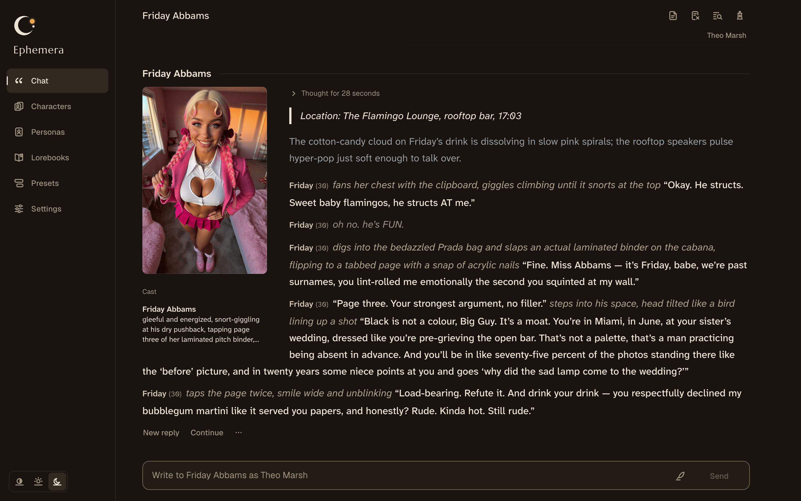
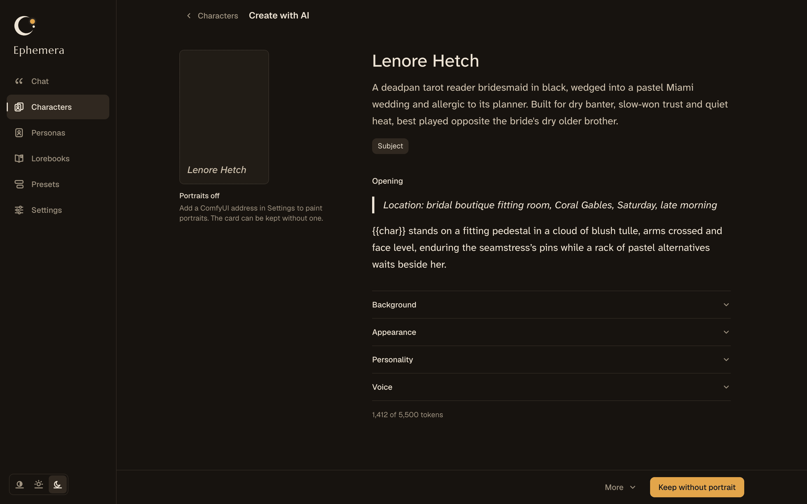
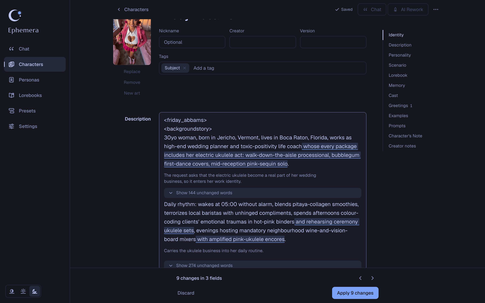
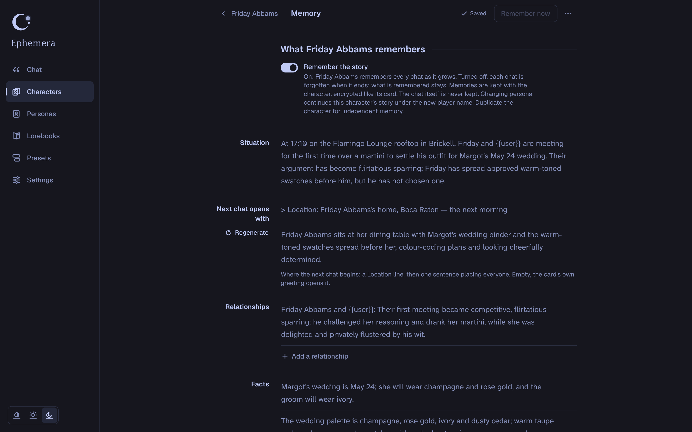
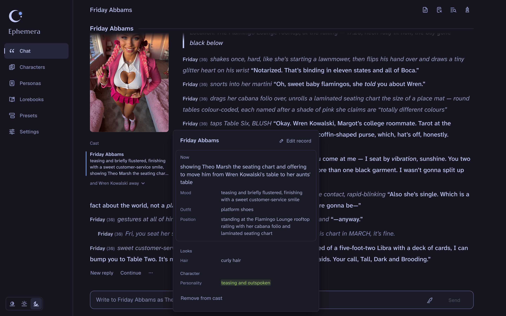
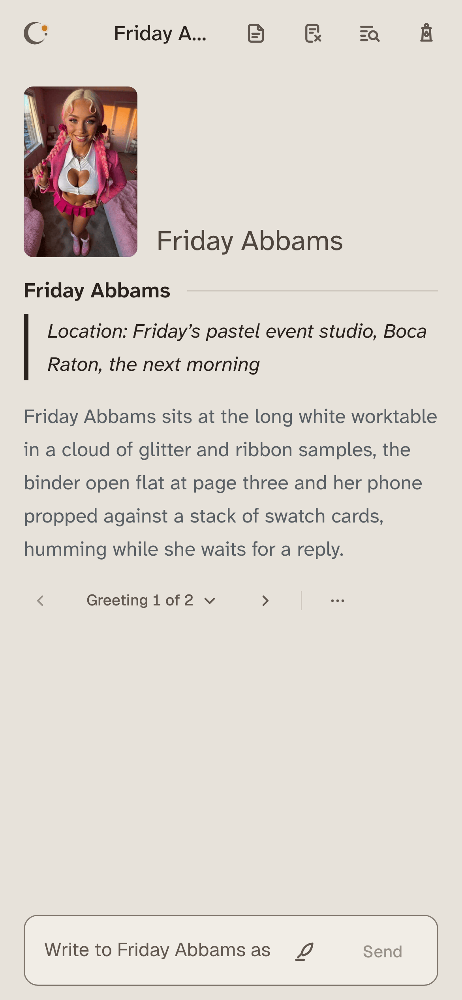
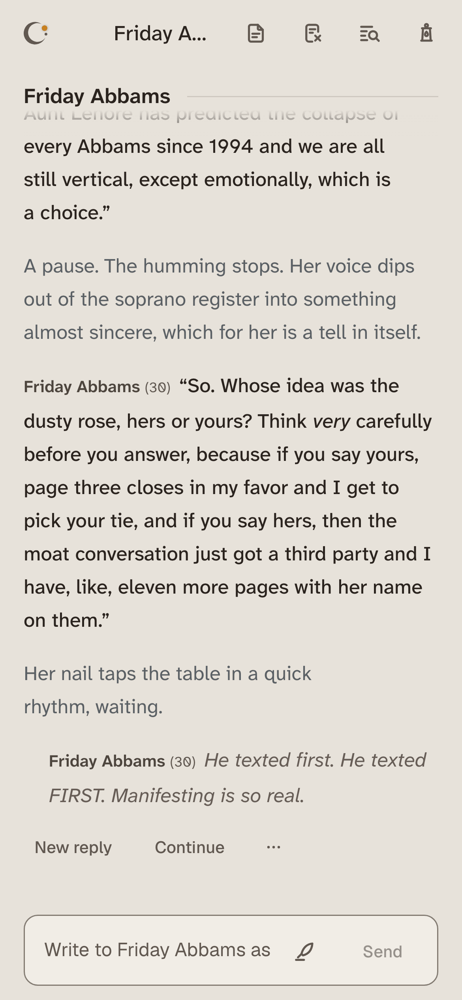
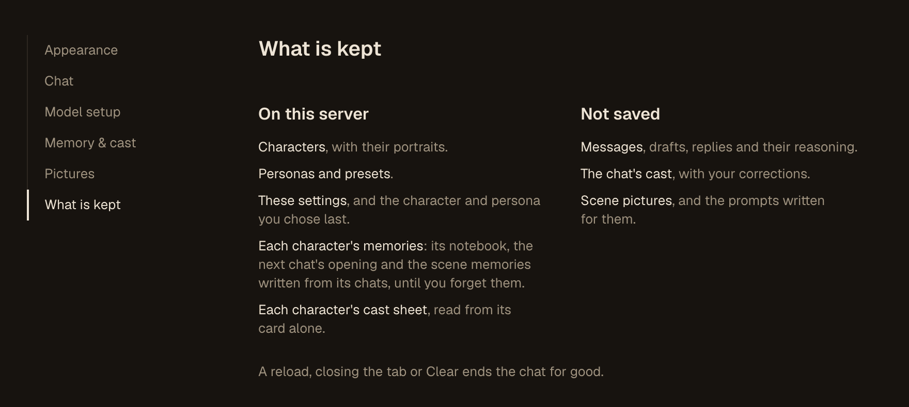

<p align="center">
  
</p>

<h1 align="center">Ephemera</h1>

<p align="center">
  <strong>A modern, opinionated roleplay interface where your characters stay and your conversations don't.</strong><br>
  Bring your SillyTavern cards. Every chat vanishes when you close the tab.
</p>

<p align="center">
  <a href="LICENSE"></a>
  
  
  
  
</p>

<p align="center">
  <a href="#get-started"><strong>Get started</strong></a> ·
  <a href="#with-your-ai-assistant">Set up with AI</a> ·
  <a href="#model-providers">Model providers</a> ·
  <a href="#sister-project-atelier">Sister project: Atelier</a>
</p>

<p align="center">
  
</p>

Ephemera is a self-hosted roleplay chat that makes the choices for you: cards
written for models, one formatting language, memory and story events that work
without tuning. Your characters, personas, lorebooks and presets are saved and
encrypted per user. Your conversations never touch a disk.

- **Opinionated.** It ships with defaults that work, so there is little to
  tune. Replies arrive in one consistent format of scene, actions and speech,
  and a keeper tracks who is present and what they wear.
- **Fully featured.** AI card creation and rework, memory, story events,
  lorebooks, presets, SillyTavern import, pictures, themes and a phone layout,
  all in one interface.
- **Private by design.** Chats live in the open tab and nowhere else. What is
  saved is encrypted per user on your own server. The browser loads nothing
  from third parties, and the server talks only to the model upstream and image
  backend you configure.

Every screenshot here is the real interface with real model output. The
chats are with the bundled example character, Friday Abbams.

## Highlights

### ✦ Create with AI
Describe a character, a group or a whole scenario in a few words. The model
writes a complete card, consistent with the persona you play, and paints
portrait candidates when an image backend is connected.

<p align="center">
  
</p>

### ✦ AI Rework
Tell the model what should change in an existing card. Its edits arrive as
tracked changes, each with a reason, for you to accept or reject one by one.

<p align="center">
  
</p>

### ✦ Memory
Characters remember. An editable notebook of where the story stands, memories
of what happened and the next chat's opening carry over, saved encrypted as
character data. The turns themselves are never saved. On by default, switchable
per character.

<p align="center">
  
</p>

### ✦ Cast register
After each reply a keeper notes who is in the scene: their mood, what they
wear, where they stand and what they are doing. Open a record from the cast
panel to read or correct it, so outfits, positions and names stay consistent.

<p align="center">
  
</p>

### ✦ Events
One-line story directions that fire by chance, with cooldowns and scopes, so
scenes keep moving without you steering every turn.

### ✦ Phones and themes
Layouts built for phones, tablets and desktops, in light and dark themes and
six palettes, Tokyo Night by default, with custom palettes of your own. Here the next chat with Friday
opens where the last one left off, the morning after.

<p align="center">
  
  &nbsp;&nbsp;
  
</p>

## Also included

- **SillyTavern import**: Character Card V2 and V3 from PNG or JSON with
  embedded lorebooks, World Info books and Chat Completion presets, with a
  report of what was kept, changed or left out
- **Chat**: streaming, swipes, regenerate, continue, impersonate, edits with
  undo, and a prompt inspector that shows exactly what was sent
- **Lorebooks and presets**: a lorebook library linked to any character,
  ordered prompt blocks, an Author's Note, independent sampler presets and a
  macro engine for `{{char}}`, `{{user}}` and more
- **Pictures**: portraits and scene pictures through ComfyUI or [Atelier](https://github.com/SneakyShadyLurker/atelier-studio), with
  your own ComfyUI workflows imported in Settings or mounted on the server
- **An example character**: one card ships with the server, Friday Abbams with
  her portrait, so a new library has someone to talk to from the first visit

## Zero chat retention

Chat messages, drafts, assembled prompts and replies live only in the open tab
and, for one request, in server memory. Cards you keep, reworks you apply and
character memory become saved, encrypted character data. A retention test
matrix guards every hop Ephemera controls; your model provider and image
backend need the settings in [docs/PRINCIPLES.md](docs/PRINCIPLES.md), such as
request logging off.

<p align="center">
  
</p>

Settings > What is kept lists the same split inside the app.

## Get started

You need Windows 10 or 11, macOS or Linux, a model provider with an
OpenAI-compatible API (a hosted one such as OpenRouter, or a local server
such as Ollama) and a current Chromium-based browser. Everything else is
installed for you.

### With your AI assistant

Paste this into Claude Code, Codex or any assistant that can run commands:

```text
Install Ephemera on this computer from https://github.com/SneakyShadyLurker/ephemera.
Clone it and work in the clone. Ask me which model provider I use and for its API key
(base URLs are in the README's "Model providers" table; local servers need no key), then
which of its models chats should start with. Then run ./ephemera setup --yes --upstream
'<base URL>' --model '<model ID>' (.\ephemera.cmd on Windows) with the key in the
EPHEMERA_UPSTREAM_API_KEY environment variable, and fix whatever it reports until it
succeeds. Never print .env. Finish with ./ephemera doctor, give me the address it
serves, and remind me to back up EPHEMERA_DATA_KEY from .env.
```

### On Windows

Open PowerShell (right-click Start, then Terminal) and paste:

```powershell
irm https://raw.githubusercontent.com/SneakyShadyLurker/ephemera/main/install.ps1 | iex
```

It installs everything into your user account, adds an Ephemera shortcut
to the Start menu and the desktop, asks whether to start Ephemera when you
sign in, and runs the setup below. Afterwards the shortcut starts Ephemera
and opens it, and `ephemera update` in any terminal updates it. Your
settings and library live in `%LOCALAPPDATA%\Ephemera`. To remove
Ephemera, run `ephemera stop`, then delete that folder and the Ephemera
shortcuts.

### On macOS and Linux

```sh
git clone https://github.com/SneakyShadyLurker/ephemera.git
cd ephemera
./ephemera setup
```

Setup installs Bun if it is missing, asks for your model provider and key,
checks that they work, lets you pick the model chats start with, builds the
app and opens it at `http://localhost:8780`. From then on:

| Command | Does |
|---|---|
| `./ephemera start` | Starts in the background and opens your browser |
| `./ephemera stop` | Stops, saving your library first |
| `./ephemera status` | Shows whether it runs, where and since when |
| `./ephemera update` | Pulls the latest version, rebuilds and restarts |
| `./ephemera doctor` | Checks the setup and says what to fix |

On Windows the same commands run without the `./`. `./ephemera help` lists
the rest. Each new library starts with the example
character; delete her like any card, or set `EPHEMERA_STARTER_CHARACTER=off`
in `.env` to start new libraries empty.

> [!IMPORTANT]
> Your library is encrypted under `EPHEMERA_DATA_KEY` in `.env`
> (`%LOCALAPPDATA%\Ephemera\.env` on Windows). Copy it into your password
> manager: without it, nothing can open your library again.

### For several people

To share one server, or reach it from other devices, run `./ephemera
setup` and choose "Several people, or from other devices". Ephemera then
waits behind a trusted authentication proxy of yours that signs people in
and passes their username (for example SWAG with Authelia). The hardened
container and its deploy checklist are in
[docs/ARCHITECTURE.md](docs/ARCHITECTURE.md) § Deployment.

### Development

`bun run dev` serves the app with live reload at `http://localhost:5173`
from the same `.env`. `bun run check` runs typecheck, lint, unit tests and
the persistence audit; `bun run test:e2e` runs the Playwright flows and
retention scans.

## Model providers

Ephemera talks to one OpenAI-compatible upstream, set for the whole server in
`.env` (or `infra/docker/.env` for the container). `./ephemera setup` offers
these and writes it for you:

```sh
EPHEMERA_UPSTREAM_BASE_URL=https://openrouter.ai/api/v1
EPHEMERA_UPSTREAM_API_KEY=your-key   # leave empty for a local server without one
EPHEMERA_DEFAULT_MODEL=vendor/model  # optional: the model new libraries start with
```

Restart the server after a change (`./ephemera restart`). The model list comes from the provider's
`/models`, and every model picker also takes a model ID typed in full. Where the
provider reports a model's context window, reasoning levels or image input,
Ephemera uses them; where it does not, set the window in Settings > Model setup,
under Context, before chatting with that model.

| Provider | Base URL | Key | Context windows reported |
|---|---|---|---|
| OpenRouter | `https://openrouter.ai/api/v1` | Required | Yes |
| DeepSeek | `https://api.deepseek.com` | Required | Yes |
| Groq | `https://api.groq.com/openai/v1` | Required | Yes |
| Mistral | `https://api.mistral.ai/v1` | Required | Yes |
| Together AI | `https://api.together.ai/v1` | Required | Yes |
| vLLM | `http://<host>:8000/v1` | Only if started with one | Yes |
| llama.cpp server | `http://<host>:8080/v1` | Only if started with one | No |
| Ollama | `http://<host>:11434/v1` | None | No |
| LM Studio | `http://<host>:1234/v1` | Only if enabled | No |
| CLIProxyAPI | `http://<host>:8317/v1` | One of its client keys | Yes |

Each chat sends a prompt cache key (`prompt_cache_key` and an
`x-session-affinity` header) so providers that cache prompts can reuse them. A
provider that refuses the field gets the request again without it, and the
server stops sending it; `EPHEMERA_UPSTREAM_SESSION_CACHE=off` turns it off from
the start. A provider that refuses the output cap (`max_tokens`) or the
streamed usage request (`stream_options`) by name gets the request again
without that field; the usage request then stays off, and token counts show as
not reported. Inside the container, `localhost` is the container itself: point a
server on the host at an address the container can reach, such as
`host.docker.internal`.

## Sister project: Atelier

**[Atelier](https://github.com/SneakyShadyLurker/atelier-studio)** is a
self-hosted image and video studio from the same author, also AGPL and built
on Bun. One prompt box reaches cloud, bring-your-own-key and local ComfyUI
models, and your images stay yours.

The two apps run independently and work well together:

- **Pictures in chat**: Ephemera can use Atelier as its image backend for
  portraits and scene pictures.
- **Image to card**: an optional action on a finished Atelier image sends it
  to Ephemera, which writes a character card from it.

Neither app needs the other.

## Documentation

[Product](docs/PRODUCT.md) · [Principles](docs/PRINCIPLES.md) ·
[Architecture](docs/ARCHITECTURE.md)

## License

[GNU AGPL v3.0 only](LICENSE). Ephemera is meant for adults; operators decide
who they admit.
